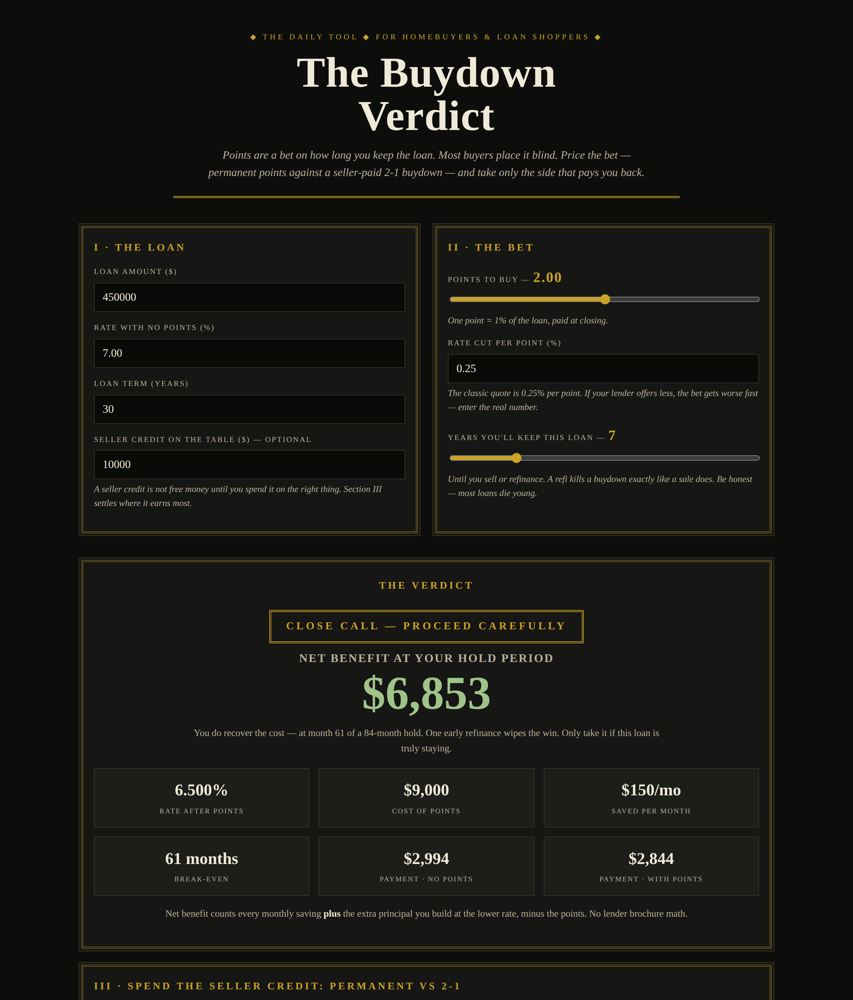

# The Buydown Verdict

**Live:** https://thebullbrew.github.io/buydown-verdict/
**Repo:** https://github.com/thebullbrew/buydown-verdict

## What it does

Points are a bet on how long you keep the loan — and most buyers place it blind. The Buydown Verdict prices the bet honestly:

- **Permanent points, priced** — enter the loan, base rate, points, and the *actual* rate cut per point your lender quoted (not the 0.25% folklore). You get the bought rate, monthly saving, true break-even month, and net benefit at your hold period — counting both the payment savings *and* the extra principal the lower rate builds.
- **BUY / SKIP / CLOSE CALL verdict** — based on whether break-even lands comfortably inside, barely inside, or beyond how long you'll actually keep the loan (selling *or refinancing* both kill a buydown).
- **Seller credit showdown** — the same credit spent two ways: funding a temporary 2-1 buydown (rate −2% year one, −1% year two, with its true subsidy cost) vs. buying permanent points. The tool names the winner for your hold period.
- **Every point, priced** — a 0 to 4-point sensitivity table with rate, payment, cost, break-even, and net, so you can watch the fourth point turn into a donation.
- Saveable scenarios (localStorage) and a copy-ready summary for comparing lender quotes side by side.

## The method

1. Points only pay if you outlive the break-even month. One early refinance and you funded the lender's margin.
2. The rate cut per point is negotiable and varies daily — a 0.125% cut nearly doubles break-even. Always price the quoted cut.
3. Seller credit changes the bet: points bought with the seller's money can win on a short hold, and a seller-funded 2-1 is a pure gift — compare both before signing.

## How to run

Open `docs/index.html` in any browser, or visit the live link above. Fully static, works offline as a PWA, no backend, no data leaves your device.

Design: dark old-money variation 3 — Brass & Ink.
